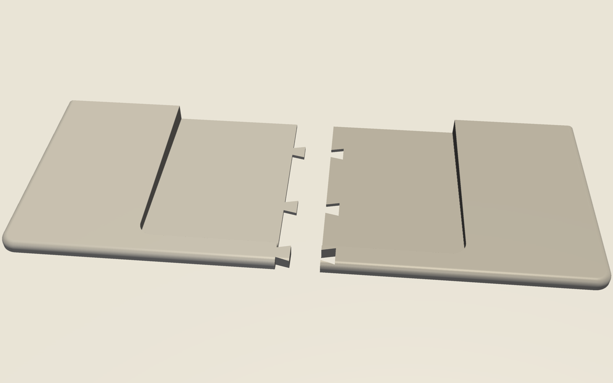

# Handrest

3D-printable palm rest that sits centred in front of a NuPhy Air75 V2 and holds an
Apple Magic Trackpad flush with its surface, like the lower half of a MacBook.

- Same width as the keyboard: 316.4 x 129.7 mm.
- The top surface is one plane with the trackpad's slope: 6.2 mm at the front, 12.9 mm at the back.
- The trackpad drops into a pocket with a 2 mm floor and 0.4 mm clearance per side.
- The pocket is open at the back, so the USB-C port and the power switch stay reachable.
- The top front and side edges are rounded with a 4 mm radius. Seen from above, the front corners are rounded with a 10 mm radius.
- The back edge is square, so the rest stays flush right up to the keyboard.
- Four 10.5 x 1 mm recesses underneath take rubber bumpons.


## Print on a Bambu Lab printer

Print the two halves, one per plate. Each half fits every Bambu printer, including the A1 mini (180 x 180 mm).

| File | Size (mm) | A1 mini | A1 / P1S / P2S / X1C | H2D |
|---|---|---|---|---|
| `out/handrest_left.3mf` | 166.1 x 129.7 x 12.9 | fits | fits | fits |
| `out/handrest_right.3mf` | 158.2 x 129.7 x 12.9 | fits | fits | fits |
| `out/handrest_full.3mf` | 316.4 x 129.7 x 12.9 | no | no | tight, only 4.3 mm free per side |

1. In Bambu Studio, open `handrest_left.3mf`.
2. Leave it flat side down, as it loads. Do not rotate it on its side.
3. Slice with 0.20 mm layers, 3 walls and 15 % infill, with no supports. Use PLA or PETG.
4. Print it, then repeat with `handrest_right.3mf`.
5. Slide the dovetails together and glue them with CA or PLA glue.

STL versions of the same parts are also in `out/`.



## Change dimensions

Edit the constants at the top of `handrest.py`, then rebuild, verify and render:

```sh
uv venv -p 3.11 .venv && uv pip install -p .venv build123d pyvista
.venv/bin/python handrest.py   # writes out/
.venv/bin/python verify.py     # checks pocket, flush top, split, plate fit
.venv/bin/python render.py     # writes renders/
```

Measure your trackpad's corner radius first. `TP_CORNER_R` defaults to 8 mm. If the
trackpad fits too tight or too loose, change `CLEARANCE`.
