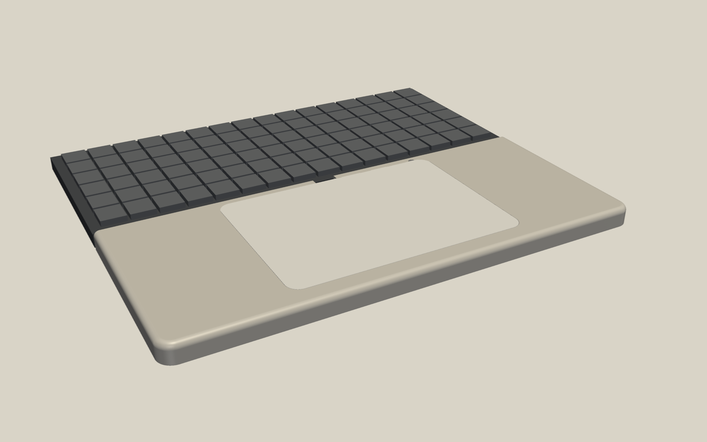
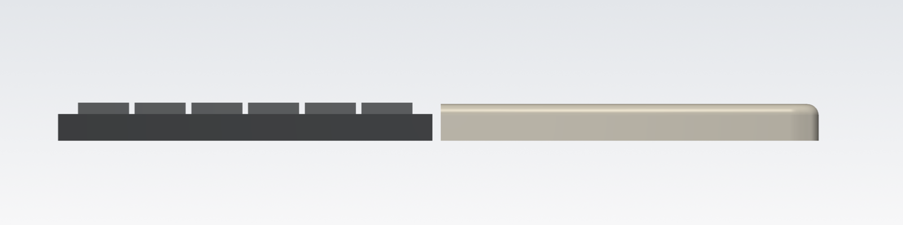
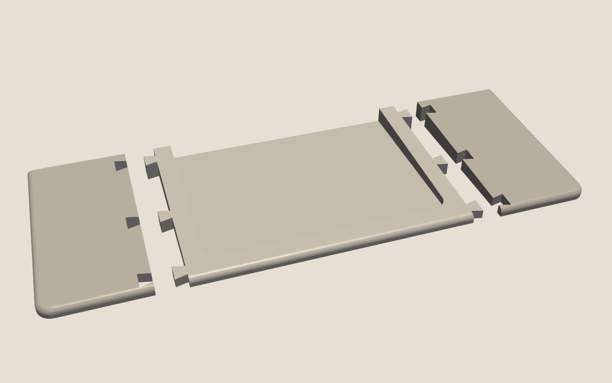

# Handrest

3D-printable palm rest that sits centred in front of a NuPhy Air75 V2 and holds an
Apple Magic Trackpad flush with its surface, like the lower half of a MacBook.

- Same width as the keyboard: 316.4 x 129.7 mm.
- The top surface is one plane with the trackpad's slope: 6.2 mm at the front, 12.9 mm at the back.
- The trackpad drops into a pocket with a 2 mm floor and 0.4 mm clearance per side.
- The pocket is open at the back, so the USB-C port and the power switch stay reachable.
- The top front and side edges are rounded with a 4 mm radius. Seen from above, the front corners are rounded with a 10 mm radius.
- The back edge is square, so the rest stays flush right up to the keyboard.
- Four 10.5 x 2.5 mm recesses underneath take 10 mm rubber bumpons. They stick out about 0.5 mm, so the rest stays just below the keyboard's height.




## Print on a Bambu Lab printer

The rest prints as three pieces: a centre piece that holds the trackpad, and two side wings.
The seams run through the solid wings, not through the thin floor under the trackpad.
You need a 256 mm plate (A1, P1S, P2S, X1C, H2D). The centre piece is too wide for the A1 mini.

| Plate | File | Size (mm) |
|---|---|---|
| 1 | `out/handrest_centre.3mf` | 200.5 x 129.7 x 12.9 |
| 2 | `out/handrest_wings.3mf` (both wings) | 141.6 x 129.7 x 12.9 |

1. In Bambu Studio, open `handrest_centre.3mf`. Leave it flat side down, as it loads.
2. Slice with 0.20 mm layers, 3 walls and 15 % infill, with no supports. Use PLA or PETG.
3. Print it, then do the same with `handrest_wings.3mf`.
4. Slide each wing onto the centre piece from above. Glue the dovetails with CA or PLA glue.
5. Press four 10 mm bumpons into the recesses underneath.

`handrest_wing_left.3mf` and `handrest_wing_right.3mf` hold one wing each, if you want to print them separately.
STL versions of every part are also in `out/`.



## Change dimensions

Edit the constants at the top of `handrest.py`, then rebuild, verify and render:

```sh
uv venv -p 3.11 .venv && uv pip install -p .venv build123d pyvista
.venv/bin/python handrest.py   # writes out/
.venv/bin/python verify.py     # checks pocket, flush top, seams, plate fit
.venv/bin/python render.py     # writes renders/
```

Measure your trackpad's corner radius first. `TP_CORNER_R` defaults to 8 mm. If the
trackpad fits too tight or too loose, change `CLEARANCE`.
